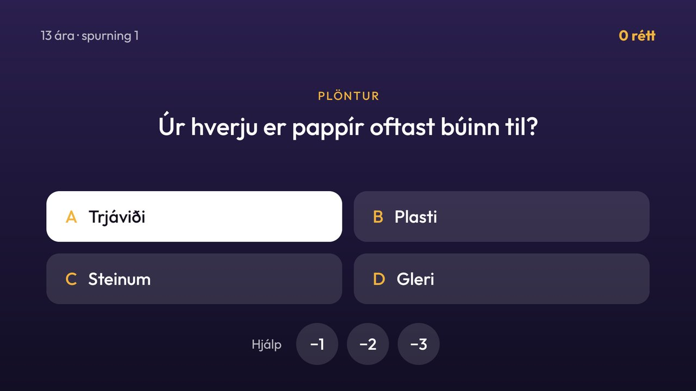

# Spurningakeppni

An Icelandic quiz for the whole household, as its own app beside the launcher. Pick a difficulty (7, 10, 13 or
adults), then answer four-choice questions until the first wrong answer. Each game has three helpers, one of each:
remove one, two or three wrong answers. A wrong answer shows the right one and a short fact. Each difficulty has a
top ten kept on the TV; a game that makes it asks for a name, and names used before are offered again so nobody
has to type twice.

A run has breaks. After every fifth right answer the player picks the next question's subject from two. After
every tenth, a player who has used a helper is offered the big question: a harder one, from the difficulty above,
that wins the largest used helper back if it is answered right. A run earns bronze at 5 right, silver at 10 and
gold at 20, shown as a badge and in the colour of the screen.

The questions are general knowledge in Icelandic across sixteen subjects, pitched so that an average person of
that age gets about 5 to 10 right in a row: `app/src/main/assets/questions.txt`, checked by
`tests/test_quiz_questions.py`.

## Remote controls

- Arrows move between the difficulties, the answers and the helpers; OK chooses.
- An answer glows amber for a moment, then turns green or red. The remote waits until the next question.
- Back during a game asks whether to stop; Back elsewhere goes to the start, and Back on the start leaves.
- Names are typed on an Icelandic letter grid: the first letter of each word is a capital.



## Permissions

None. No network, account, background service or telemetry. Local SharedPreferences hold the four leaderboards,
the names used on them and which questions have been asked. Automatic backup is off.

## Build

JDK 17 and Android SDK 34, as for the launcher:

```sh
./gradlew --no-daemon testReleaseUnitTest lintRelease assembleRelease
```

Install it as the add-ons README describes. To open it from Home, add its package to `top_bar_apps` in the
theme (a round button with its icon) or map a remote button to it with `app_keys`:
`io.github.palliarinbj.spurningar`.

The font is Outfit, under the SIL Open Font License (`FONT-LICENSE-OFL.txt`), as in the launcher.

## Validation

Tried on a TCL 75C745 (Google TV 14) at 1920×1080 with D-pad events from ADB: the start screen, a 13 ára game with
the −2 helper, a right and a wrong answer, the leaderboard place, the letter grid, the boards, and Back during a
game (the stop prompt keeps focus on its two buttons). The screenshot above is from that TV.
